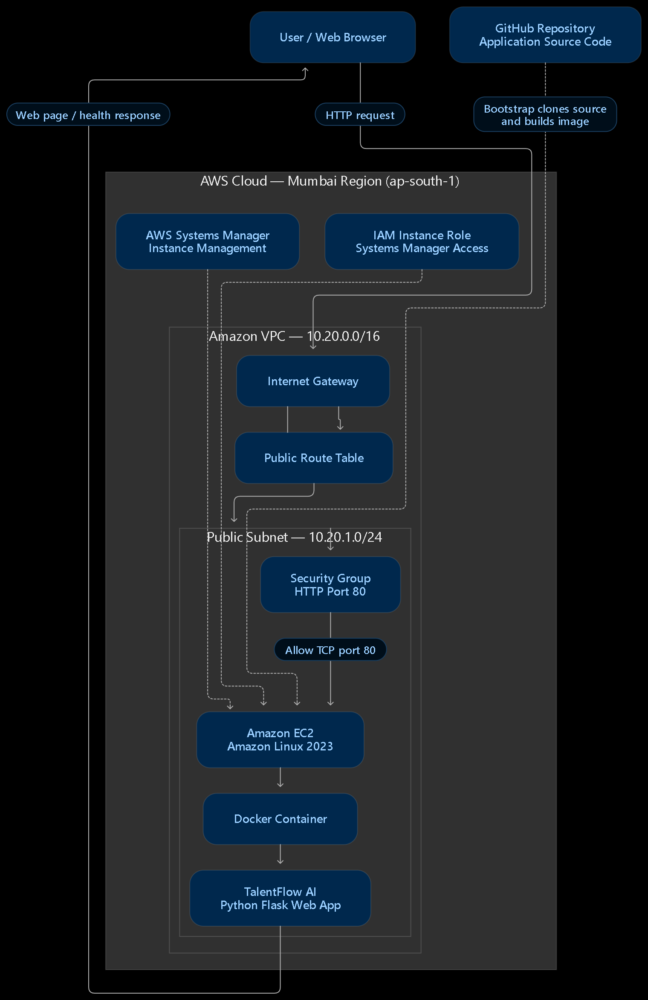

<<<<<<< HEAD
# TalentFlow AI — AWS Cloud Platform

**Author:** Shree Dhadge  
**Status:** Sample app starter. AWS deployment is not yet verified.

This is a student-built sample recruitment website inspired by the supplied project guide. It is not the original TalentFlow application and does not use a real AI model yet.

## Local run (Windows PowerShell)

```powershell
py -m venv .venv
.\.venv\Scripts\Activate.ps1
python -m pip install --upgrade pip
pip install -r requirements.txt
python app.py
```

Open `http://127.0.0.1:5000`. Health check: `http://127.0.0.1:5000/health`.

If activation is blocked:
```powershell
Set-ExecutionPolicy -Scope Process -ExecutionPolicy Bypass
.\.venv\Scripts\Activate.ps1
```

## Features
- Sample job listings
- Candidate application form
- Optional local resume upload (PDF, DOC, DOCX; max 5 MB)
- SQLite local demo database
- `/health` endpoint
- Docker starter

## Planned AWS design
Internet → public Application Load Balancer → application compute in private subnets → private RDS. Resumes use a private S3 bucket. SQS/Lambda can process events and SNS can notify. CloudWatch provides logs and alarms.

## Safety and honesty
Use fictional test data only. Never commit credentials, `.env`, private keys, or real resumes. This starter is not production-ready. Only mark AWS services as deployed after you actually deploy and verify them. Terraform is intentionally not used; infrastructure will be written in CloudFormation.

## Structure
```text
app.py
requirements.txt
Dockerfile
.dockerignore
.gitignore
app/templates/index.html
app/static/style.css
db/schema.sql
cloudformation/README.md
lambda/README.md
iam/README.md
scripts/cleanup-checklist.md
docs/setup-windows.md
docs/architecture.md
docs/troubleshooting.md
docs/diagrams/README.md
docs/evidence/README.md
```
=======

# TalentFlow AI — AWS Cloud Platform

**Project by:** Shree Dhadge

## Overview

TalentFlow AI is an AI-powered recruitment platform project
focused on building secure, scalable and highly available
cloud infrastructure on Amazon Web Services (AWS).

The platform is designed to support candidate applications,
resume storage, background processing, recruiter notifications
and application monitoring.

## Architecture



## AWS Services

- Amazon VPC
- Amazon EC2
- Elastic Load Balancing (ALB)
- EC2 Auto Scaling
- Amazon S3
- Amazon RDS
- AWS Lambda
- Amazon SQS
- Amazon SNS
- Amazon EventBridge
- Amazon CloudWatch
- AWS IAM
- AWS CloudFormation
- Amazon ECR and Docker

Additional services such as CloudFront, Route 53, CloudTrail
and AWS Config will be included where implemented.

## Main Features

- Secure AWS network architecture
- Load balancing and automatic scaling
- Private database connectivity
- Secure resume storage
- Event-driven background processing
- Monitoring, logs and alarms
- Infrastructure as Code using CloudFormation

## Repository Structure

- `app/` — Application source code
- `cloudformation/` — AWS infrastructure templates
- `lambda/` — Background processing functions
- `iam/` — IAM policy definitions
- `db/` — Database schema
- `scripts/` — Deployment and testing scripts
- `docs/` — Architecture and project documentation

## Project Status

Implementation in progress.

Only verified and deployed features will be marked as completed.

## Security

Never commit AWS credentials, private keys, database passwords,
environment files or personal candidate data.

## Author

Shree Dhadge
>>>>>>> f87107313eb8ac36c3b4112d4e4d75a03d49f167
